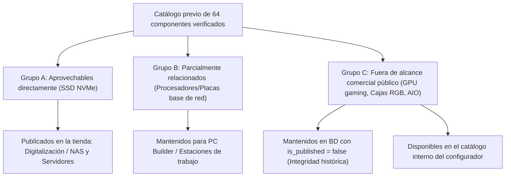

# NODRIA — Documento Interno de Correspondencia Curricular
## Ciclo Formativo de Grado Superior en Sistemas de Telecomunicaciones e Informáticos (CFGS STI)

> **Documento de uso estrictamente interno para la defensa del proyecto técnico fin de ciclo.**
> Este documento no forma parte de la navegación pública ni de la presentación comercial de NODRIA. Su propósito es justificar detalladamente ante el tribunal evaluador la correspondencia pedagógica, curricular y técnica entre las asignaturas del título oficial (Real Decreto 883/2011) y el catálogo comercial estructurado en la plataforma.

---

## 1. Contexto Curricular y Marco Académico

El proyecto **NODRIA** materializa una plataforma integral de comercio electrónico y gestión operativa para el sector de las telecomunicaciones y la digitalización técnica. Con el objetivo de reflejar un entorno profesional verosímil y competitivo, la plataforma adopta la identidad corporativa de un distribuidor tecnológico especializado (**NODRIA Tecnología S.L.**), erradicando deliberadamente cualquier elemento o lenguaje escolar en la interfaz pública de usuario.

El catálogo técnico ha sido diseñado para dar cobertura completa y equilibrada a los cinco módulos profesionales centrales del currículo oficial del **CFGS en Sistemas de Telecomunicaciones e Informáticos**:

| Módulo Profesional (Currículo Oficial) | Categoría Comercial en NODRIA | Código / Slug del Sistema |
| :--- | :--- | :--- |
| **1. Técnicas y procesos en infraestructuras de telecomunicaciones** | **Infraestructuras de Telecomunicaciones** | `infraestructuras-telecomunicaciones` |
| **2. Elementos de sistemas de telecomunicaciones** | **Equipos y Sistemas de Telecomunicaciones** | `equipos-sistemas-telecomunicaciones` |
| **3. Sistemas integrados y hogar digital** | **Domótica y Hogar Digital** | `domotica-hogar-digital` |
| **4. Sistemas de telefonía fija y móvil** | **Telefonía y Comunicaciones** | `telefonia-comunicaciones` |
| **5. Digitalización aplicada a los sectores productivos** | **Digitalización e Industria Conectada** | `digitalizacion-industria-conectada` |

---

## 2. Correspondencia por Módulo Profesional

### Módulo 1: Técnicas y procesos en infraestructuras de telecomunicaciones
- **Código y Denominación:** Módulo Profesional 0363 — *Técnicas y procesos en infraestructuras de telecomunicaciones*.
- **Categoría Pública:** `Infraestructuras de Telecomunicaciones`.
- **Objetivos de Aprendizaje y Competencias:**
  - Montaje y configuración de envolventes, armarios rack y cuadros de distribución de telecomunicaciones (RIT / RITI / RITS).
  - Despliegue, guiado y conexionado de cableado estructurado en cobre de altas prestaciones (Cat.6A / Cat.7) y fibra óptica (OS2 / OM4).
  - Cumplimiento de la normativa sobre reacción al fuego de materiales de construcción (Reglamento CPR EN 50575, cubiertas LSZH).
  - Verificación, ensayo instrumental y certificación de enlaces permanentes y canales mediante instrumentación de laboratorio.
  - Empalme por fusión térmica con alineación de núcleo en redes de distribución óptica FTTH y enlaces troncales.

#### Subcategorías y Justificación Técnica
1. `racks-armarios` (Racks y armarios de comunicaciones): Cubre envolventes murales (Legrand 9U) y armarios de suelo para CPD (Schneider 42U) conforme a norma EIA/ECA-310-E.
2. `cableado-estructurado` (Cableado estructurado Cat.6A/Cat.7): Bobinas de 500m y 305m con blindajes U/FTP y S/FTP para redes de alta velocidad 10GbE exentas de halógenos.
3. `fibra-optica` (Fibra óptica y distribución troncal): Mangueras preconectorizadas con tracción reforzada y bandejas repartidoras telescópicas 1U con conectores SC/APC.
4. `paneles-parcheo` (Paneles de parcheo y gestión de cable): Paneles de parcheo modulares Keystone con toma de tierra y pasahilos de radio protegido.
5. `herramientas-certificacion` (Herramientas profesionales y certificación): Equipos de alta precisión para certificación de enlaces (Fluke DSX-602) y fusionadora por alineación de núcleo de 6 motores (Televes 232103).

#### Productos Seleccionados (10 referencias):
- `NDR-TEL-INF-001` — Rack Mural 19" 9U Profundidad 600mm Puerta de Cristal (Legrand 446209) — 189,50 €
- `NDR-TEL-INF-002` — Armario Rack de Suelo 19" 42U 800x1000mm con Guías de Gestión (Schneider Electric NSYVD24U84P) — 849,00 €
- `NDR-TEL-INF-003` — Bobina Cable de Red U/FTP Cat.6A LSZH 500m 500MHz Libre de Halógenos (Televes 219901) — 265,00 €
- `NDR-TEL-INF-004` — Bobina Cable de Red S/FTP Cat.7 PIMF 1000MHz 305m Apantallado (Televes 219910) — 215,00 €
- `NDR-TEL-INF-005` — Manguera Fibra Óptica Preconectorizada Monomodo OS2 12 Fibras LC-LC 50m (Legrand 032585) — 142,90 €
- `NDR-TEL-INF-006` — Bandeja Distribuidora de Fibra Óptica 19" 1U 24 Puertos SC/APC con Pigtails (Televes 233003) — 118,00 €
- `NDR-TEL-INF-007` — Panel de Parcheo 19" 24 Puertos Cat.6A FTP 1U con Guía Trasera (Schneider Electric VDIB17726B12) — 82,50 €
- `NDR-TEL-INF-008` — Organizador de Cables Horizontal 19" 1U con Tapa Frontal y 5 Anillas (Legrand 646520) — 24,90 €
- `NDR-TEL-INF-009` — Certificador de Redes de Cobre Cat.6A/Cat.8 Fluke DSX-602 INTL (Fluke Networks DSX-602-INTL) — 1.450,00 €
- `NDR-TEL-INF-010` — Fusionadora de Fibra Óptica por Alineación de Núcleo 6 Motores (Televes 232103) — 1.290,00 €

---

### Módulo 2: Elementos de sistemas de telecomunicaciones
- **Código y Denominación:** Módulo Profesional 0364 — *Elementos de sistemas de telecomunicaciones*.
- **Categoría Pública:** `Equipos y Sistemas de Telecomunicaciones`.
- **Objetivos de Aprendizaje y Competencias:**
  - Configuración y puesta en servicio de equipos de conmutación de nivel 2 y nivel 3 (VLAN 802.1Q, agregación de enlaces LACP, Spanning Tree).
  - Implementación de pasarelas de red y enrutadores multi-WAN con inspección de tráfico y cortafuegos perimetral.
  - Planificación y despliegue de redes de área local inalámbricas (WLAN) en bandas Wi-Fi 6E y Wi-Fi 7 (802.11ax/be).
  - Selección e interconexión de interfaces ópticas mediante módulos transceptores SFP/SFP+ monomodo y multimodo con telemetría DDM.
  - Procesamiento y distribución de señales de radiodifusión sonora y de televisión digital (DVB-T/T2, DVB-S/S2) en cabeceras comunitarias.

#### Subcategorías y Justificación Técnica
1. `switches-gestionables` (Switches gestionables capa 2/3 y PoE+): Conmutadores Gigabit/10G con PoE+ y PoE++ para energizar equipamiento de red empresarial (Ubiquiti USW-Pro-24, Cisco Catalyst 1000).
2. `routers-borde` (Routers de borde y balanceo de carga): Enrutadores multi-WAN de alto rendimiento con firewall IPS/IDS y RouterOS (Ubiquiti UDM-SE, MikroTik RB5009).
3. `puntos-acceso-wifi` (Puntos de acceso inalámbrico Wi-Fi 6E/7): Equipos de techo de alta densidad con modulación 4096-QAM y soporte de controladores centralizados.
4. `transceptores-opticos` (Módulos transceptores ópticos SFP/SFP+): Interfaces de enlace a 10 Gbps en fibra monomodo de 1310 nm y convertidores de cobre 10GBASE-T.
5. `cabeceras-rf-tv` (Cabeceras de radiofrecuencia y distribución TV/SAT): Centrales digitales programables con filtros selectivos y transmoduladores satélite a COFDM.

#### Productos Seleccionados (10 referencias):
- `NDR-TEL-EQT-011` — Switch Gestionable L3 24 Puertos Gigabit PoE+ y 2 SFP+ 10G UniFi Pro (Ubiquiti USW-Pro-24-POE) — 689,00 €
- `NDR-TEL-EQT-012` — Switch Gestionable 48 Puertos Gigabit PoE+ y 4 SFP+ Cisco Catalyst 1000 (Cisco C1000-48P-4X-L) — 1.150,00 €
- `NDR-TEL-EQT-013` — Router de Agregación de Borde y Firewall UniFi Dream Machine SE (Ubiquiti UDM-SE) — 519,00 €
- `NDR-TEL-EQT-014` — Router de Borde Multi-WAN Gigabit RouterBOARD RB5009UG+S+IN (MikroTik RB5009UG+S+IN) — 219,00 €
- `NDR-TEL-EQT-015` — Punto de Acceso Wi-Fi 7 Tri-Banda Empresarial UniFi U7 Pro (Ubiquiti U7-Pro) — 198,00 €
- `NDR-TEL-EQT-016` — Punto de Acceso Wi-Fi 6 AX3000 de Techo para Alta Densidad cAP AX (MikroTik cAPGi-5HaxD2HaxD) — 139,00 €
- `NDR-TEL-EQT-017` — Transceptor Óptico SFP+ 10G LR Monomodo 1310nm 10km DDM (Ubiquiti UACC-OM-SM-10G-D-2) — 68,00 €
- `NDR-TEL-EQT-018` — Módulo Transceptor SFP+ 10GBASE-T RJ45 Cobre hasta 30m (MikroTik S+RJ10) — 59,90 €
- `NDR-TEL-EQT-019` — Central Amplificadora Programable de Cabecera Avant X Pro UHF/VHF/FM (Televes 532121) — 295,00 €
- `NDR-TEL-EQT-020` — Transmodulador Óptico de Cabecera DVB-S2 a DVB-T/C con Ranura CI (Televes 565101) — 479,00 €

---

### Módulo 3: Sistemas integrados y hogar digital
- **Código y Denominación:** Módulo Profesional 0367 — *Sistemas integrados y hogar digital*.
- **Categoría Pública:** `Domótica y Hogar Digital`.
- **Objetivos de Aprendizaje y Competencias:**
  - Integración de pasarelas y controladores domóticos basados en estándares abiertos interoperables (Matter, Zigbee 3.0, Thread, Z-Wave Plus).
  - Implementación de actuadores para cuadro eléctrico (carril DIN) y micromódulos empotrables para control de iluminación, fuerza y monitorización energética.
  - Instalación y parametrización de sensórica avanzada de presencia mediante radares de ondas milimétricas (mmWave) y monitores de calidad de aire interior.
  - Conexión y securización de sistemas de control de accesos, cerraduras inteligentes y videoportería sobre protocolo IP PoE.
  - Regulación inteligente de climatización mediante termostatos modulantes con protocolo digital OpenTherm y válvulas termostáticas motorizadas.

#### Subcategorías y Justificación Técnica
1. `pasarelas-controladores` (Pasarelas y controladores domóticos): Hubs multiprotocolo capaces de enlazar ecosistemas cerrados y abiertos con ejecución local y redundancia PoE.
2. `reles-actuadores` (Micromódulos y relés inteligentes para carril DIN): Dispositivos de conmutación de cargas de hasta 16A/40A con vatímetro integrado y comunicación MQTT.
3. `sensores-ambientales` (Sensores ambientales, de presencia y consumo): Detectores espaciales mmWave con segmentación de áreas y sensores de TVOC / temperatura.
4. `videoporteros-control-acceso` (Videoporteros IP y control de accesos): Intercomunicadores 2K con lector NFC integrado y cerraduras motorizadas compatibles con Apple Home Key.
5. `climatizacion-inteligente` (Termostatos y gestión climática inteligente): Termostatos con algoritmos de modulación PID y cabezales termostáticos autónomos.

#### Productos Seleccionados (10 referencias):
- `NDR-TEL-DOM-021` — Hub Domótico Multiprotocolo Zigbee 3.0, Matter y Thread Aqara Hub M3 (Aqara HM-G01E) — 129,99 €
- `NDR-TEL-DOM-022` — Controlador Domótico Z-Wave Plus y Zigbee Home Center 3 Lite (Fibaro FGHC3L-001) — 139,00 €
- `NDR-TEL-DOM-023` — Relé Inteligente 4 Canales para Carril DIN con Medición de Potencia Shelly Pro 4PM (Shelly SHELLY-PRO-4PM) — 89,90 €
- `NDR-TEL-DOM-024` — Micromódulo Interruptor Empotrable Zigbee 3.0 con Medición Shelly 1PM Gen3 (Shelly SHELLY-1PM-G3) — 22,90 €
- `NDR-TEL-DOM-025` — Sensor de Presencia Humana por Radar Milimétrico mmWave FP2 Aqara (Aqara PS-S02D) — 82,99 €
- `NDR-TEL-DOM-026` — Sensor Ambiental de Calidad de Aire Temperatura y Humedad TVOC Zigbee (Aqara AAQS-S01) — 44,90 €
- `NDR-TEL-DOM-027` — Videoportero IP PoE con Cámara 2K y Lector NFC UniFi G4 Doorbell Pro PoE (Ubiquiti UVC-G4-Doorbell-Pro-PoE) — 379,00 €
- `NDR-TEL-DOM-028` — Cerradura Electrónica Inteligente Zigbee con Teclado Táctil y Biometría Aqara U200 (Aqara EL-D02D) — 269,99 €
- `NDR-TEL-DOM-029` — Termostato Inteligente Modulante OpenTherm y Relé para Caldera/Bomba de Calor (Schneider Electric CCTFR6700) — 179,00 €
- `NDR-TEL-DOM-030` — Cabezal Termostático Inteligente para Radiador Zigbee con Pantalla LED Shelly TRV (Shelly SHELLY-TRV) — 69,90 €

---

### Módulo 4: Sistemas de telefonía fija y móvil
- **Código y Denominación:** Módulo Profesional 0368 — *Sistemas de telefonía fija y móvil*.
- **Categoría Pública:** `Telefonía y Comunicaciones`.
- **Objetivos de Aprendizaje y Competencias:**
  - Diseño, dimensionamiento y configuración de centralitas telefónicas IP-PBX bajo protocolo SIP (Session Initiation Protocol).
  - Gestión de interfaces analógicas y digitales tradicionales mediante pasarelas FXS, FXO e ISDN/RDSI BRI para migración escalonada.
  - Despliegue de puestos de operador y terminales VoIP ejecutivos con códecs de banda ancha (G.722, Opus) y cifrado SRTP/TLS.
  - Planificación de sistemas de telefonía móvil corporativa y movilidad inalámbrica en estándar DECT multisede.
  - Implementación de routers y módems celulares industriales 4G LTE y 5G con redundancia dual SIM y antenas directivas exteriores.

#### Subcategorías y Justificación Técnica
1. `centralitas-ip-pbx` (Centralitas IP-PBX y servidores SIP): Servidores autónomos de comunicaciones unificadas con capacidad de hasta 1000 extensiones y grabación de llamadas.
2. `telefonos-ip-dect` (Teléfonos IP de sobremesa y terminales inalámbricos DECT): Terminales ejecutivos con pantalla a color y sistemas inalámbricos multisede para almacén y planta.
3. `gateways-voip` (Pasarelas VoIP analógicas y digitales FXS/FXO/PRI): Pasarelas de interconexión de líneas PSTN y extensiones convencionales con paso de fax T.38.
4. `routers-celulares-4g-5g` (Routers y módems celulares industriales 4G/5G): Pasarelas celulares de grado industrial con conmutación por fallo automática y túneles VPN WireGuard/IPsec.
5. `antenas-comunicaciones` (Antenas móviles M2M/IoT y amplificadores de señal): Antenas de alta ganancia omnidireccionales MIMO y sistemas repetidores homologados bajo Directiva RED.

#### Productos Seleccionados (10 referencias):
- `NDR-TEL-TEL-031` — Centralita Telefónica IP-PBX Grandstream UCM6302 hasta 1000 Usuarios y 150 Llamadas (Grandstream UCM6302) — 429,00 €
- `NDR-TEL-TEL-032` — Centralita Telefónica IP Compacta Grandstream UCM6204 con 4 Puertos FXO (Grandstream UCM6204) — 349,00 €
- `NDR-TEL-TEL-033` — Teléfono IP Ejecutivo Yealink SIP-T54W con Pantalla Color 4.3" y Wi-Fi/Bluetooth (Yealink SIP-T54W) — 169,50 €
- `NDR-TEL-TEL-034` — Sistema Telefónico Inalámbrico DECT IP Yealink W73P Base + Terminal (Yealink W73P) — 119,00 €
- `NDR-TEL-TEL-035` — Pasarela VoIP FXS 16 Puertos Grandstream GXW4216 para Extensiones Analógicas (Grandstream GXW4216) — 269,00 €
- `NDR-TEL-TEL-036` — Gateway VoIP Digital ISDN BRI 2 Puertos Patton SmartNode SN4120 (Patton SN4120/2BIS4V) — 389,00 €
- `NDR-TEL-TEL-037` — Router Celular Industrial 4G LTE Cat 4 Dual SIM Teltonika RUT241 (Teltonika RUT241) — 139,00 €
- `NDR-TEL-TEL-038` — Router Celular Industrial 5G y Wi-Fi 6 Dual SIM Teltonika RUTX50 (Teltonika RUTX50) — 529,00 €
- `NDR-TEL-TEL-039` — Antena Exterior Omnidireccional 4G/5G MIMO 698-3800 MHz 6 dBi (Teltonika PR1US440) — 75,00 €
- `NDR-TEL-TEL-040` — Amplificador de Señal Móvil 4G/5G Multibanda para Interiores StellaHome (Televes 403001) — 499,00 €

---

### Módulo 5: Digitalización aplicada a los sectores productivos
- **Código y Denominación:** Módulo Profesional — *Digitalización aplicada a los sectores productivos*.
- **Categoría Pública:** `Digitalización e Industria Conectada`.
- **Objetivos de Aprendizaje y Competencias:**
  - Adquisición masiva de datos en planta y convergencia de redes operacionales (OT) con redes corporativas (IT).
  - Implementación de protocolos industriales abiertos (Modbus TCP/RTU, OPC Unified Architecture y telemetría MQTT).
  - Despliegue de nodos de computación en el borde (Edge Computing) fanless con aceleración para analítica de datos e inferencia local de IA.
  - Almacenamiento centralizado tolerante a fallos para copias de seguridad de procesos, almacenamiento de series temporales y gemelos digitales.
  - Captura automatizada de datos, identificación por código de barras 2D / RFID y trazabilidad logística en la cadena de suministro.

#### Subcategorías y Justificación Técnica
1. `gateways-iot-industriales` (Gateways IoT y adquisición de datos en planta): Equipos con procesador industrial y conectividad dual Ethernet/Serie para puenteo OT/IT.
2. `servidores-edge-computacion` (Servidores Edge y computación industrial): Microservidores embebidos sin ventilación forzada resistentes a vibraciones y amplios rangos térmicos.
3. `almacenamiento-nas-servidores` (Almacenamiento en red NAS empresarial): Cabinas de almacenamiento en torre y en rack 1U con sistemas de archivos Btrfs y aceleración NVMe.
4. `sensores-industriales-modbus` (Sensores industriales e interfaces Modbus / IO-Link): Sondas de proceso e instrumentación de presión y temperatura con salida digital.
5. `captura-datos-trazabilidad` (Terminales de captura de datos y trazabilidad logística): Lectores portátiles Android de uso rudo con sellado IP68 e impresoras industriales térmicas.

#### Productos Seleccionados (12 referencias, integrando referencias de almacenamiento SSD del catálogo base):
- `NDR-TEL-DIG-041` — Gateway IoT Industrial Edge Advantech UNO-2271G-V2 con Modbus y MQTT (Advantech UNO-2271G-V2) — 489,00 €
- `NDR-TEL-DIG-042` — Módulo de E/S Remotas Modbus TCP Ethernet Phoenix Contact Axioline Smart Elements (Phoenix Contact AXL-SE-SC-A) — 215,00 €
- `NDR-TEL-DIG-043` — Servidor Edge Fanless Industrial Advantech ARK-1220L para Inferencia IA (Advantech ARK-1220L-S6A1E) — 699,00 €
- `NDR-TEL-DIG-044` — Micro Servidor Edge Fanless con Doble 2.5GbE y 4 Puertos Serie Moxa V2201 (Moxa V2201-E4-W-T) — 579,00 €
- `NDR-TEL-DIG-045` — Servidor de Almacenamiento en Red NAS 4 Bahías Synology DiskStation DS923+ (Synology DS923+) — 629,00 €
- `NDR-TEL-DIG-046` — Servidor de Almacenamiento NAS en Rack 19" 1U 4 Bahías Synology RackStation RS822+ (Synology RS822+) — 989,00 €
- `REF-SNV3SM31T0-0ETE5` — SSD Kingston NV3 1TB M.2 2230 PCIe 4.0 NVMe 6000MB/s 3D NAND Gaming (Kingston SNV3SM3/1T0) — 269,73 € *(Reclasificado desde catálogo base: Almacenamiento de alta velocidad para NAS y nodos Edge)*
- `REF-MZV9P1T0BW-1VOPO` — Samsung 990 Pro 1TB Disco SSD 7450MB/S NVMe PCIe 4.0 M.2 Gen4 (Samsung MZ-V9P1T0BW) — 218,99 € *(Reclasificado desde catálogo base: Caché NVMe de baja latencia para almacenamiento en red)*
- `NDR-TEL-DIG-047` — Sensor Industrial de Temperatura y Humedad Modbus RTU RS-485 IP65 (Schneider Electric METSETH01) — 79,50 €
- `NDR-TEL-DIG-048` — Transmisor de Presión Industrial 4-20mA y Modbus RTU 0-10 Bar Acero Inoxidable (Schneider Electric XMLP010BC71F) — 115,00 €
- `NDR-TEL-DIG-049` — Terminal Portátil PDA Móvil Industrial con Lector 2D Zebra TC22 (Zebra TC220K-01B112-A6) — 549,00 €
- `NDR-TEL-DIG-050` — Impresora Industrial de Etiquetas y Códigos de Barras Térmica Zebra ZT231 (Zebra ZT23142-T0E000FZ) — 729,00 €

---

## 3. Estrategia de Preservación y Clasificación del Catálogo Existente

Para dar estricto cumplimiento al principio de no destrucción de datos ni rotura de dependencias operativas, el catálogo previo de componentes de PC se ha clasificado en tres grupos estratégicos:

1. **Grupo A (Aprovechables directamente):**
   - Las unidades de estado sólido SSD NVMe (Samsung 990 Pro, Kingston NV3, Adata Legend, Crucial T500, etc.) se reclasifican funcionalmente en la categoría `digitalizacion-industria-conectada` bajo la subcategoría `almacenamiento-nas-servidores`. En un entorno real de telecomunicaciones e industria digital, estas unidades actúan como discos de arranque para servidores de comunicaciones, almacenamiento de series temporales en pasarelas IoT y caché de lectura/escritura en cabinas NAS.

2. **Grupo B (Parcialmente relacionados):**
   - Placas base con doble interfaz Ethernet 2.5GbE y conectividad Wi-Fi 6E/7, así como procesadores multihilo con gráficos integrados y bajo consumo TDP. Se preservan en el motor del **PC Builder** para el dimensionamiento y ensamblaje de estaciones de diseño técnico y servidores locales de comunicaciones.

3. **Grupo C (Claramente fuera de alcance comercial público):**
   - Componentes estrictamente orientados al juego recreativo (tarjetas gráficas dedicadas gaming, chasis con iluminación ARGB de cristal templado, sistemas de refrigeración líquida gaming).
   - **Tratamiento técnico:** Se conservan íntegramente en la base de datos PostgreSQL de Supabase marcados con `is_published = false` para el catálogo público. Esto garantiza que:
     - Ningún pedido histórico existente en `orders` o `order_items` sufra fallos de integridad referencial de clave externa.
     - El módulo interno del PC Builder (`lib/pc-builder`) conserve la disponibilidad de componentes para pruebas de compatibilidad.
     - El storefront público de NODRIA mantenga una coherencia visual y temática 100% orientada al sector de telecomunicaciones.

---

## 4. Justificación de la Identidad Comercial Profesional

La decisión de proyectar a NODRIA como una tienda online real y solvente obedece a tres criterios formativos y metodológicos fundamentales:

1. **Simulación Empresarial Fidedigna:** En el ámbito de la ingeniería de software y la integración de sistemas, el diseño centrado en el usuario final exige reproducir fielmente la experiencia real de un cliente corporativo (B2B) o profesional instalador (B2C), evitando sesgos de "proyecto escolar".
2. **Evaluación Basada en Competencias Reales:** La defensa técnica ante el tribunal evalúa la capacidad de concebir productos digitales comercialmente viables, con arquitecturas seguras, flujos de compra idénticos a los estándares de mercado y cumplimiento riguroso de normativas (técnicas, de privacidad y de accesibilidad).
3. **Erradicación de Clichés Visuales y Académicos:** La ausencia deliberada de referencias a asignaturas o institutos en la navegación y fichas técnicas dota a la plataforma de rigor comercial, mientras que este documento interno (`docs/CORRESPONDENCIA_CURRICULAR.md`) aporta la trazabilidad pedagógica requerida por el marco formativo oficial.
